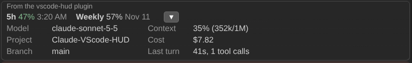

# Claude-VScode HUD

A Claude Code mod (plugin name `vscode-hud`) that draws a one-line band above
the prompt with your subscription usage, plus an arrow that opens the rest of what you want
to see while an agent works.



A screenshot of the band in the Claude Code extension for VS Code, with the
arrow opened. Closed, only the usage row and the arrow show.

## The usage row

Each window shows the percentage used and when it resets: a clock time if the
reset is within 24 hours, otherwise a date. The percentage is green below 50%,
yellow from 50% to 80%, and red from 80%. The row stays empty until Claude Code
reports rate-limit data, which only happens on a subscription plan after the
first reply.

## Pace warning

Each window is compared with how much of it has passed. A window used faster
than the clock gets a `fast` tag. When the current rate would fill the window
before it resets, the row says `runs out in 1h 12m`, and a toast appears once
per window reset. Very early in a window (under 5% elapsed) or at low use (under
5%) nothing is judged, because the rate is too noisy. The opened lines add a
`pace` line per window with the numbers.

Turn it off with the `paceWarning` option in the plugin's config menu.

## The arrow

Press the arrow (or `s` while the band has focus) to open or close these lines.
It points right when closed and down when open.
Lines with no data yet are left out. In a wide panel the lines sit in two
columns, and a `Pace` row appears under them only when a window is ahead of the clock; when the panel is too narrow for two they stack in one column.

| Line | What it shows |
| --- | --- |
| Model | The session model id |
| Project | The working folder name |
| Branch | The git branch and the number of changed files, for example `main +2` |
| Context | Context window used, for example `42% (84k/200k)` |
| Cost | The session cost in US dollars, where Claude Code keeps a ledger |
| Last turn | How long the last turn took and how many tool calls it made |
| Todos | The agent's todo progress and the task in progress |

The git lines run read-only `git branch --show-current` and `git status
--porcelain` in the session folder, after each turn. Nothing is sent anywhere.

The band is drawn on the terminal, desktop and VS Code surfaces. In VS Code the
host adds its own "From the vscode-hud plugin" label and frame around it.

## What it runs, sends and reads

Nothing is sent anywhere. The mod makes no network calls, writes no files, and
opens no connections. It does not read any credential, token or environment
variable.

It runs exactly two programs, both `git`, both read-only, in the session
folder, with a 3 second limit each, after each turn and at session start:

- `git branch --show-current`, to show the branch name.
- `git status --porcelain`, to count changed files for the `main +2` style label.

If `git` is missing or the folder is not a repository, those lines are left out.
The commands are fixed text in the source, never built from user input.

Everything else comes from what Claude Code already holds for the session: the
rate-limit windows, context size, model id and cost (through
`$.session.usage()` and `$.session.model()`). Branch names, folder names and
todo text are stripped of control characters and cut to 60 characters before
they are drawn.

## What each hook does

| Hook | What the mod does |
| --- | --- |
| `session.start` | Remembers the session folder, reads usage, model and git info once. |
| `session.measure` | Updates the usage windows, context and cost when Claude Code reports a change. Raises the pace toast when a window would run out before its reset, at most once per window per reset. |
| `prompt.submit` | Starts the turn timer and resets the tool-call count. |
| `tool.call` | Counts tool calls. For `TodoWrite` calls, also reads the todo list to show progress. It never changes, blocks or delays a call. |
| `turn.complete` | Stores the turn time and refreshes the git and model lines. |
| `ui.render` (`AbovePrompt`) | Draws the band. Returns nothing when a survey is showing. |

Every hook passes the event on unchanged.

## Theme

Colors are theme roles (success, warning, error and the dim text style), not fixed
hex values, so the host paints them from your own VS Code theme. The band adds
no background of its own. Switching the theme restyles it with no setting.

## Install

At the prompt of a terminal session:

```
/plugin install vscode-hud --marketplace LuuHung247/Claude-VScode-HUD
```

From a shell:

```
claude plugin install vscode-hud --marketplace LuuHung247/Claude-VScode-HUD
```

Answer `y` to add the marketplace, then choose a scope. Claude Code 2.1.319 or
newer is required.

## Develop

```
claude plugin validate .
claude plugin test .
claude --plugin-dir .
```

## Related projects

The HUD idea comes from [jarrodwatts/claude-hud](https://github.com/jarrodwatts/claude-hud),
which shows context, tools, agents and todos in the status line. This mod draws
above the prompt instead, using Claude Code's mod API.

## License

MIT
