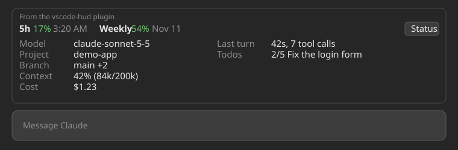

# usage-band

A Claude Code mod that draws a single line above the prompt showing how much of
your subscription usage you have used, for example:

```
5h 17% 3:20 AM  Weekly 54% Nov 11
```



The image is an illustration of the layout, not a screenshot.

Each window shows the percentage used and when it resets: a clock time if
the reset is within 24 hours, otherwise a date. The percentage is green below
50%, yellow from 50% to 80%, and red from 80%. The band stays hidden until
Claude Code reports rate-limit data, which only happens on a subscription plan
after the first reply.

The band is drawn on the terminal, desktop and VS Code surfaces. In VS Code the
host adds its own "From the usage-band plugin" label above it.

## Install

At the prompt of a terminal session:

```
/plugin install usage-band --marketplace LuuHung247/usage-band
```

From a shell:

```
claude plugin install usage-band --marketplace LuuHung247/usage-band
```

Answer `y` to add the marketplace, then choose a scope.

## Develop

```
claude plugin validate .
claude plugin test .
claude --plugin-dir .
```

Claude Code 2.1.319 or newer is required.

## License

MIT
